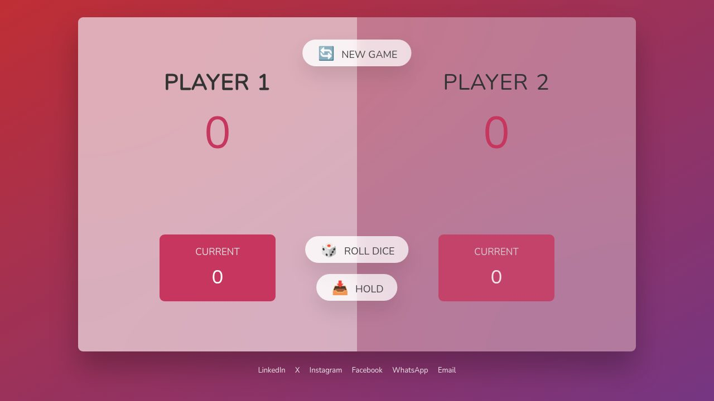

# Pig Game

A two-player dice game on one screen. Roll to collect points, hold to keep them, and race to 100.

**Play it:** https://mhmd7710d.github.io/Pig-Game-Project/

## How to play
1. Player 1 starts. Press **Roll dice** to add a roll to the current score.
2. Press **Hold** to add the current score to your total and pass the turn.
3. Rolling a 1 throws away the current score and passes the turn.
4. The first player to reach 100 wins. **New game** resets everything.

## Built with
Plain HTML, CSS and JavaScript. No libraries and no build step.

## What I practised
Game state in variables, functions and event handlers, random numbers, conditionals, and updating the page and the player highlight from JavaScript.

## Run it locally
Download the repository and open `index.html` in a browser.

## Credits
A learning project based on Jonas Schmedtmann's Complete JavaScript Course.

## Contact
- LinkedIn: https://www.linkedin.com/in/muhammad-fathi-b7a693424/
- X (Twitter): https://x.com/mouahid7710
- Facebook: https://www.facebook.com/share/1CQhxpCeYL/
- Instagram: https://www.instagram.com/mhmd7710d/
- Email: muhammutfathi@gmail.com
- WhatsApp: https://wa.me/201040428475?text=Hi+Muhammad%2C+I+found+your+project+on+GitHub.
